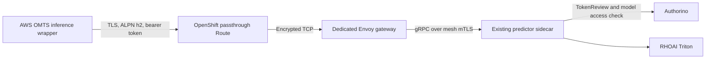

# Why the hybrid demo uses a dedicated Triton gRPC Route

> [!NOTE]
> This project was developed with assistance from AI tools.

This document explains the external inference path verified on 2026-10-23.
The AWS VM runs the OMTS application and Gazebo simulation; RHOAI runs Triton
and its RF-DETR and FoundationPose models. The tested stack was OpenShift
4.20.26, RHOAI 2.25.9 and Service Mesh 2.6.17. Live addresses, credentials and
raw evidence remain in ignored local files.

## Problem

The AWS inference client could not call the RHOAI-hosted Triton gRPC API through
the original controller-owned re-encrypt OpenShift Route. The request path was:

```text
AWS client → OpenShift router → OAuth proxy → Triton gRPC port
```

Triton gRPC requires HTTP/2. For a TLS connection, Application-Layer Protocol
Negotiation (ALPN) establishes that protocol as `h2`. A reachable HTTPS hostname
and a valid bearer token alone do not establish a usable gRPC connection.

Our diagnosis identified three problems in that path:

| Component | Finding | Effect |
| --- | --- | --- |
| Original Route | TLS negotiation returned no ALPN protocol; the Route used the router's default certificate. | The external client could not establish the required HTTP/2 connection. |
| OAuth proxy | Its TLS listener advertised HTTP/1.1. | Fixing the public certificate alone would leave an incompatible proxy hop. |
| Proxy upstream | An HTTP upstream pointed at Triton's gRPC port. | Pointing ordinary HTTP at the port did not supply a working gRPC transport. |

OpenShift documents the custom-certificate requirement for router-terminated
HTTP/2 and explains that passthrough can negotiate HTTP/2 directly between
client and backend. See [OpenShift 4.20 HTTP/2 ingress behavior](https://docs.redhat.com/en/documentation/openshift_container_platform/4.20/html/networking_operators/configuring-ingress).
The [OAuth proxy TLS implementation](https://github.com/openshift/oauth-proxy/blob/master/http.go)
sets its default advertised protocol to `http/1.1`, consistent with our diagnosis.

We therefore needed a complete HTTP/2-capable path, with TLS verification and
model-scoped token authentication preserved. Editing only the existing Route's
certificate would not address the downstream proxy. Changes to controller-owned
resources would also be vulnerable to reconciliation.

## Solution

We added a project-owned passthrough Route, `hybrid-triton-grpc`, targeting a
dedicated Envoy mesh gateway, `hybrid-triton-gateway`. The original generated
Route remains available. The new gateway reaches the existing RHOAI predictor
through the internal `triton-rhoai-grpc` Service.



### TLS and HTTP/2 terminate at Envoy

The OpenShift router forwards the encrypted connection using its hostname
instead of terminating TLS. Envoy presents a certificate for that hostname and
negotiates `h2` with the AWS client. OpenShift documents that passthrough HTTP/2
does not require the router's HTTP/2 setting to be enabled, because the backend
performs ALPN negotiation. [OpenShift ingress documentation](https://docs.redhat.com/en/documentation/openshift_container_platform/4.20/html/networking_operators/configuring-ingress).

The gateway Service exposes port 443 and targets Envoy port 8443. cert-manager
generates the serving certificate and private key in the cluster; a read-only
Secret volume mounts them into Envoy. The client receives only the public CA
certificate and verifies both the certificate chain and the endpoint hostname.

### The gateway preserves the existing authorization path

The VirtualService routes approved Triton RPCs to the internal Service on port
9000. A DestinationRule uses `ISTIO_MUTUAL` for the gateway-to-predictor hop.
The gateway sets both the HTTP authority and `k-original-host` to
`triton-rhoai-grpc.${RHOAI_NAMESPACE}.svc.cluster.local`, matching the internal
AuthConfig. This selects the intended authorization configuration; it does not
grant access by itself.

The wrapper sends `authorization: Bearer <token>` as gRPC metadata. The existing
predictor mesh authorization policy invokes Authorino, which:

1. Validates the service-account token through Kubernetes TokenReview, with
   audience `https://kubernetes.default.svc`.
2. Uses SubjectAccessReview to require `get` permission on the named
   InferenceService in the selected project.

The external client uses the existing authorized model client service account.
The gateway service account has no Secret-read API permission. Authentication
therefore remains enforced even though this path avoids the OAuth proxy.

Only health/readiness, metadata, model configuration and unary `ModelInfer`
methods are exposed. Repository operations, model load/unload and streaming
RPCs fall through to an HTTP 403 response.

### The actual AWS demo uses this endpoint

The VM's inference wrapper was adapted to open a secure remote gRPC channel,
read the mounted token for every RPC and disable shared memory across machines.
KServe retains backend model load/unload ownership; the wrapper checks model
readiness. Readiness/metadata calls have 15-second deadlines, inference calls
have 120-second deadlines, and message sizes are bounded at 128 MiB.

The guarded overlay updates the owning `resources` ChartAssignment so the
hybrid settings survive workload reconciliation. It checks the saved owner UID
and spec hash, and preserves a rollback plan. Cached executables and build
caches are reused. The adapter provides no fallback to local Triton inference.

The endpoint and workstation target settings come from the hybrid-only,
schema-validated `config.local.json`. That live file and the generated
compatibility `.env` remain ignored by Git. The model token stays in a separate
VM Kubernetes Secret; token contents are never stored in JSON.

The implementation is maintained in:

| File | Responsibility |
| --- | --- |
| [grpc-ingress.yaml](manifests/grpc-ingress.yaml) | Certificates, gateway, RPC routing, mesh TLS, ingress policy and passthrough Route. |
| [Internal Service and AuthConfig](../../openshift/rhoai/manifests/triton-grpc-internal-service.yaml) | Predictor Service selection and model-scoped token authorization. |
| [hybrid_triton.py](hybrid_triton.py) | Secure client channel, per-RPC credentials, deadlines and wrapper adaptation. |
| [prepare_vm_overlay.py](prepare_vm_overlay.py), [vm_overlay.py](vm_overlay.py) | Owner configuration, drift guards and rollback. |
| [verify_grpc.py](verify_grpc.py) | Transport, authentication, authorization and synthetic inference checks. |

## Conclusion

The dedicated Route resolved the tested protocol mismatch while retaining TLS
verification and model-scoped authorization. The AWS VM now runs the demo and
simulation while RHOAI Triton performs inference.

Verification covered more than a standalone client:

- External workstation and AWS VM connections negotiated ALPN `h2` with strict
  certificate and hostname verification.
- Missing or invalid tokens returned `UNAUTHENTICATED`; a valid token without
  model access returned `PERMISSION_DENIED`. Authorized inference succeeded.
- Administrative model-load requests were rejected; gateway restart checks
  passed without replacing the existing predictor.
- Two additional full cycles were observed through noVNC after scene resets.
  Each AWS executive operation reported `SUCCEEDED` for pick, load, machining,
  unload and return.

Measured inference counter changes for those noVNC-observed cycles were:

| Cycle window on 2026-10-23, UTC | RHOAI RF-DETR | RHOAI FoundationPose | AWS local Triton, both models |
| --- | --- | --- | --- |
| 20:53:06–20:54:17 | +1 | +1 | 0 |
| 20:59:47–21:00:58 | +1 | +1 | 0 |

The first cycle also produced FoundationPose execution logs inside the same
RHOAI predictor pod whose counters were measured: processing began at 20:53:15
UTC and completed at 20:53:23 UTC in 8.139 seconds. The matching pod UID,
server-side operation results, pod logs and counter changes establish that the
AWS demo reached the RHOAI backend. Raw logs and pod identities remain private.

This is a verified integration for the prepared environment. Complete
fresh-clone provisioning has not been validated. The pilot uses a seven-day CA
and six-day serving certificate; CA distribution and one-hour model token
refresh remain manual. Durable operation needs managed trust distribution and
credential renewal. After a VM restart, refresh the token and check wrapper
readiness; an initialization error caused by an expired token can require a
targeted inference-pod restart.

For configuration, operating commands and recovery, use the
[hybrid runbook](README.md).
