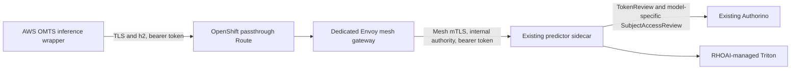

# AWS VM + RHOAI: verified hybrid demo

> [!NOTE]
> This project was developed with assistance from AI tools.

The AWS OMTS simulation now uses RHOAI-managed Triton through an OpenShift
passthrough Route with verified TLS, HTTP/2 and model-scoped bearer authentication.
This directory contains the current implementation, configuration and verification
for that path. The original failure and resolution are recorded below; earlier
experiment files remain available in Git history.

This is an interim integration checkpoint for an already prepared Intrinsic VM
and RHOAI model deployment. The complete fresh-clone provisioning sequence has
not been validated; the commands below assume the documented runtime prerequisites,
model assets, cached builds, and captured baseline/source inputs already exist.

## Verification on 2026-10-23

Two independent one-cycle demos completed after simulation resets. The executive
reported `SUCCEEDED` for pick, load, machining, unload and return in both runs.
The successful cycle windows were 18:17:41–18:18:50 UTC and
18:20:13–18:21:20 UTC. The second run increased RHOAI counters by exactly one
RF-DETR request and one FoundationPose request; the retained local Triton
sidecar had no successful inference requests. Wrapper timings were 0.242 seconds
for RF-DETR and 8.241 seconds for FoundationPose in that run.

Fresh checks from the AWS VM negotiated `h2` with certificate and hostname
verification. Inference without a token or with an invalid token returned
`UNAUTHENTICATED`; a valid token without model access returned
`PERMISSION_DENIED`. The authorized model remained Ready.

Both upstream commits and all recorded cache directory identities match the
saved baseline. All 6,030 Core source files match; OMTS differs only in the
scoped unload-contact patch described below. Runtime rollback was exercised
with successful native inference before the final cutover. Its current server
dry-run and the source patch reverse-check also pass. Raw logs, infrastructure
values, certificates and machine-readable evidence stay under ignored `.local/`.

### Original Route diagnosis

The target reports OpenShift 4.20.26, RHOAI 2.25.9 and Service Mesh 2.6.17.
The original controller-owned re-encrypt Route negotiated no ALPN protocol.
Its OAuth proxy serves HTTP/1.1 and points an HTTP upstream at Triton's gRPC
port. Changing only the Route certificate cannot establish gRPC through that
proxy. The [OpenShift Route documentation](https://docs.redhat.com/en/documentation/openshift_container_platform/4.20/html/ingress_and_load_balancing/configuring-routes)
explains the custom-certificate requirement for terminated HTTP/2 Routes;
the [OAuth proxy TLS implementation](https://github.com/openshift/oauth-proxy/blob/master/http.go)
advertises only `http/1.1`.

A separate passthrough Route and dedicated mesh gateway now pass these checks
from both an external local workstation and the AWS VM, without a port-forward:

- Certificate chain and hostname verification, with ALPN `h2`.
- Missing and invalid tokens: gRPC `UNAUTHENTICATED` for readiness and inference.
- Valid token without model permission: gRPC `PERMISSION_DENIED` for readiness
  and inference.
- Model-scoped token: server/model readiness, model metadata and synthetic
  RF-DETR inference; the first measured VM inference took 0.072 seconds.
- Zero-image outputs: FP32 `boxes [0,4]`, `scores [0]`, `visibility [0]`,
  and BOOL `masks [0,224,224]`.
- An administrative model-load RPC is rejected by the gateway.

The pilot gateway was restarted successfully. Post-restart inference passed,
both RHOAI deployments stayed Ready, and the original predictor pod was unchanged.
The AWS inference wrapper now uses this Route for actual requests to both models,
with shared memory disabled for the remote connection. This is a custom
project-owned ingress; the generated OAuth-proxy Route is outside the verified path.

## Request path



TLS terminates at Envoy, so the router's default certificate and the
HTTP/1.1 OAuth proxy are outside this request path. The predictor's existing
mesh authorization policy and internal AuthConfig still enforce the bearer
token and `get` access to the named InferenceService. The gateway overwrites
both authority and `k-original-host` with the internal AuthConfig hostname.
It exposes only readiness, metadata, configuration and unary inference RPCs;
model repository, load/unload and streaming RPCs receive HTTP 403.

The manifest creates a dedicated gateway without changing existing gateway,
model, predictor, PVC or Route resources. A named Secret volume supplies its
certificate; its service account has no permission to read Secrets through
the API. cert-manager generates and retains private keys in the cluster.
Clients receive only the public CA certificate. The seven-day pilot CA is
explicitly trusted by this client only. Use an approved certificate issuer
and a managed trust/renewal process before durable use. CA renewal changes
client trust; this pilot does not automate CA distribution or VM token rotation.

## Configuration ownership

The active ignored `.env` describes the working gRPC hybrid deployment.
Copy [`.env.sample`](.env.sample) for another environment and supply the actual
OpenShift context/project, passthrough Route endpoint (`hostname:443`), public CA,
model-scoped service account, RF-DETR/FoundationPose model names and VM SSH target.
Store no token or private-key contents in this file.

[hybrid_config.py](hybrid_config.py) is the hybrid-only configuration contract.
It validates versioned `HYBRID_*` fields, requires both models and explicit targets,
rejects unknown/duplicate/legacy REST settings, and resolves local paths relative
to the selected file. It never sources a shell file, reads a shared root `.env`,
changes `os.environ`, or changes the OpenShift-only schema/defaults. Target
arguments cannot be mixed with `--env-file`; token issuance uses its exact context.

From the repository root:

```bash
export HYBRID_ENV=approaches/aws-vm-with-rhoai/.env
python3 approaches/aws-vm-with-rhoai/hybrid_config.py --env-file "$HYBRID_ENV"
python3 approaches/aws-vm-with-rhoai/prepare_grpc_ingress.py --env-file "$HYBRID_ENV" --output .local/new-hybrid-ingress
python3 approaches/aws-vm-with-rhoai/prepare_vm_overlay.py --env-file "$HYBRID_ENV" --baseline "$BASELINE_DIR" --source-file "$WRAPPER_SOURCE_JSON" --output .local/new-hybrid-overlay
```

The first command validates local settings; the other commands only prepare
private artifacts. Verify the plan against the intended owner before applying.
The wrapper receives its endpoint, CA path and token path from the resulting
ChartAssignment PodSpec; its CA and token are mounted from a ConfigMap and Secret.
The active `.env` is workstation configuration and must not be copied to the VM
as a replacement for those runtime mounts.

## VM application integration

[hybrid_triton.py](hybrid_triton.py) supplies verified TLS and bearer credentials
read from the mounted token file for each RPC. It bounds readiness/metadata calls
to 15 seconds and inference to 120 seconds, with 128 MiB message limits. KServe
retains model lifecycle ownership; the wrapper checks remote readiness instead
of issuing administrative model-load RPCs. There is no local inference fallback.

[prepare_vm_overlay.py](prepare_vm_overlay.py) prepares an inference-only change
to the owning `resources` ChartAssignment from the saved baseline and wrapper
source snapshot. An init container verifies and patches the original source
into an `emptyDir`. A ConfigMap supplies the adapter/public CA; a separate Secret
supplies the token. [vm_overlay.py](vm_overlay.py) guards owner UID, complete spec
hash and resourceVersion, and refuses unrelated drift. A full application
reinstall or regenerated owner can overwrite the overlay; check it before running.

The simulation also required
[omts-unload-support-contact.patch](../../patches/omts-unload-support-contact.patch)
and a separate cell configuration with `robot.enclosure_object_name` set to the
actual support object. The patch permits support contact during only the 3 cm
unload lift. Collision checking stays enabled and subsequent transit keeps its
ordinary settings. The original cell configuration is preserved.

The cached `bazel-bin/src/omts_app` is a Python zip containing old sources.
Editing the checkout does not update those embedded files. [run_vm_demo.py](run_vm_demo.py)
uses the existing runfiles interpreter and stage-two bootstrap so source edits
take effect while compiled outputs and dependencies stay intact. It verifies
simulation mode/images, requires an idle executive, resets the simulation,
enables ICON and runs one bounded cycle. It requires server-side success for
all five stages; process exit zero alone is insufficient.

Refresh the token from the logged-in workstation before running:

```bash
python3 approaches/aws-vm-with-rhoai/refresh_vm_token.py --env-file approaches/aws-vm-with-rhoai/.env
```

Only the model-scoped token goes to the VM. Tokens request a one-hour lifetime
and are not refreshed automatically. The adapter reads each RPC's credentials
after Kubernetes propagates the Secret update. If the VM boots with an expired
token, the native wrapper can latch an initialization error. Refresh the token,
restart only the inference Pod, wait for its replacement and verify model
readiness before running again. This recovery was exercised on the resumed VM.

Keep the runner, `capture_vm_operation.py`, `vm_overlay.py`, the selected plan,
[demo_probe.py](../../openshift/demo_probe.py), and
[collision_probe.py](../../openshift/collision_probe.py) in a private helper
directory outside the VM checkouts. Use the corrected plan; this experiment's
active plan is named `plan-next.json`. On the VM:

```bash
export HYBRID_DIR="$HOME/.local/share/your-hybrid-experiment"
export HYBRID_PLAN="$HYBRID_DIR/plan-next.json"
python3 "$HYBRID_DIR/vm_overlay.py" apply --plan "$HYBRID_PLAN"
python3 "$HYBRID_DIR/run_vm_demo.py" --workspace "$HOME/intrinsic-omts" --config "$HYBRID_DIR/demo-config-hybrid.yaml" --evidence "$HYBRID_DIR/demo-run-unique" --probe-file "$HYBRID_DIR/demo_probe.py"
```

The `apply` command above validates the saved candidate and does not change an
already matching deployment. Add `--execute` to apply a prepared cutover plan.
Each new evidence directory contains private logs, `run.json` and `operation.json`.

## Reproduce ingress checks

Prerequisites: the existing model is Ready; `triton-rhoai-grpc` Service,
its [internal AuthConfig](../../openshift/rhoai/manifests/triton-grpc-internal-service.yaml),
predictor CUSTOM authorization policy and mesh membership are present.
The project must permit cert-manager Issuers/Certificates and mesh gateway
injection. Use the existing dedicated model client service account and its
model-specific RoleBinding. The pilot adds no GPU allocation or model storage.

Set environment values to the selected project, a unique hostname under its
ingress domain, and the existing authorized model client account. Keep real
values and rendered artifacts in ignored local files.

```bash
export RHOAI_NAMESPACE=your-project
export RHOAI_GRPC_HOST=hybrid-grpc.your-apps-domain.example
export RHOAI_CLIENT_ACCOUNT=your-model-client-sa
export RHOAI_MODEL_NAME=your-segmentation-model
export PILOT_DIR=.local/hybrid-grpc

python3 approaches/aws-vm-with-rhoai/prepare_grpc_ingress.py \
  --namespace "$RHOAI_NAMESPACE" --host "$RHOAI_GRPC_HOST" --output "$PILOT_DIR"
oc apply --dry-run=server -f "$PILOT_DIR/ingress.yaml"
oc apply -f "$PILOT_DIR/ingress.yaml"
oc rollout status deployment/hybrid-triton-gateway -n "$RHOAI_NAMESPACE" --timeout=90s
oc wait --for=condition=Ready certificate/hybrid-triton-tls \
  -n "$RHOAI_NAMESPACE" --timeout=90s

# Extract only the public CA certificate. Never export tls.key.
oc get secret hybrid-triton-ca -n "$RHOAI_NAMESPACE" \
  -o 'jsonpath={.data.tls\.crt}' | base64 --decode > "$PILOT_DIR/ca.crt"
(umask 077
  oc create token "$RHOAI_CLIENT_ACCOUNT" -n "$RHOAI_NAMESPACE" \
    --duration=10m --audience=https://kubernetes.default.svc > "$PILOT_DIR/token"
  oc create token hybrid-triton-gateway -n "$RHOAI_NAMESPACE" \
    --duration=10m --audience=https://kubernetes.default.svc > "$PILOT_DIR/unauthorized-token"
  printf '%s\n' "$RHOAI_MODEL_NAME" > "$PILOT_DIR/model"
)

uv venv .local/hybrid-client
uv pip install --python .local/hybrid-client/bin/python \
  -r approaches/aws-vm-with-rhoai/requirements.txt
.local/hybrid-client/bin/python approaches/aws-vm-with-rhoai/verify_grpc.py \
  --endpoint-file "$PILOT_DIR/endpoint" --ca "$PILOT_DIR/ca.crt" \
  --token-file "$PILOT_DIR/token" --model-file "$PILOT_DIR/model" \
  --unauthorized-token-file "$PILOT_DIR/unauthorized-token"
```

Run the same verifier from the AWS VM with the public CA certificate, endpoint,
model identifier and short-lived token files transferred through the existing
protected connection. No cluster API access or private key is needed on the VM.
The verifier uses finite RPC deadlines, bounded receive size and a synthetic
zero image. It prints statuses, timing and output shapes without endpoints,
tokens or payload contents. A result other than the known RF-DETR zero-image
contract fails the check.

## Maintained files and checks

| Files | Purpose |
| --- | --- |
| [`.env.sample`](.env.sample), [hybrid_config.py](hybrid_config.py) | Current gRPC profile and isolated validation; live values stay in ignored `.env`. |
| [hybrid_triton.py](hybrid_triton.py) | Mounted wrapper adapter: TLS, bearer authentication, RPC bounds and KServe lifecycle handling. |
| [grpc-ingress.yaml](manifests/grpc-ingress.yaml), [prepare_grpc_ingress.py](prepare_grpc_ingress.py) | Dedicated Route/gateway resources and private rendering. |
| [prepare_vm_overlay.py](prepare_vm_overlay.py), [vm_overlay.py](vm_overlay.py) | Prepare, apply and roll back the guarded owner configuration. |
| [refresh_vm_token.py](refresh_vm_token.py) | Refresh only the model-scoped VM token using the selected cluster context. |
| [capture_vm_baseline.py](capture_vm_baseline.py) | Preserve existing source modifications, runtime state and cache identities before cutover. |
| [run_vm_demo.py](run_vm_demo.py), [capture_vm_operation.py](capture_vm_operation.py) | Run a bounded simulation and require authoritative executive completion. |
| [verify_grpc.py](verify_grpc.py), [requirements.txt](requirements.txt) | Strict TLS, token rejection and synthetic RF-DETR transport checks. |
| [test_hybrid_config.py](test_hybrid_config.py), [test_hybrid_triton.py](test_hybrid_triton.py) | Configuration isolation, safe token delivery, credential rotation and deadline regressions. |

Before a demo, validate the selected profile and live owner plan, refresh the
token, confirm model readiness, then use the cached runfiles runner. Capture
RHOAI/local counters around the demo without other successful inference traffic.
Require an executive `SUCCEEDED` state and success for all five stages; an idle
executive or zero process exit alone is insufficient. Retain private evidence and
verify source/cache identities against the backup.

Repository checks run without deploying resources or invoking Bazel:

```bash
make lint-python lint-yaml check-whitespace scan-secrets
.local/hybrid-client/bin/python -m unittest discover -s approaches/aws-vm-with-rhoai -p 'test_*.py'
```

## Recovery and cleanup

### VM baseline and overwrite protection

Before changing the demo wrapper, run the baseline capture on the VM, outside
both source checkouts and all build-cache directories:

```bash
python3 capture_vm_baseline.py \
  --output "$HOME/.local/share/intrinsic-hybrid/baseline-<timestamp>"
```

[capture_vm_baseline.py](capture_vm_baseline.py) preserves both upstream Git
histories as verified bundles, their current tracked and non-ignored untracked
source files as checksum-verified archives, staged/unstaged patches, and the
inference StatefulSet, Pod, referenced ConfigMaps, ChartAssignments and
ResourceSets. Existing local modifications are part of the baseline. Secrets
are not exported. Keep a verified copy of the backup off the VM.

The VM checkouts are detached at recorded commits and already contain local
adaptations. Keep their existing paths and preserve their `.git` directories.
Do not pull, reset, clean, prune old worktrees, reinstall the application or run
`bazel clean` as part of the hybrid cutover. Continue using the existing Bazel
output bases, executables, repository cache and `intrinsic-distfiles` directory.
The capture records cache directory identities without copying or clearing
their contents; normal incremental builds may still be needed if source changes.

The inference StatefulSet is owned by a ResourceSet produced from the
cluster-scoped `resources` ChartAssignment. A Pod-only or StatefulSet-only edit
can be overwritten when its owner reconciles. Keep hybrid wiring in a separate,
versioned overlay and apply it through the owning deployment configuration;
retain the pre-cutover owner and workload specifications. Validate the live
wrapper's endpoint and patch identity after reconciliation and before each run.

Rollback must restore the saved pre-cutover owner configuration and the original
inference Pod template, wait for readiness, and verify that both native models
respond again. Remove only experiment-created wiring after native recovery.
Source recovery must restore the saved working state, including earlier local
changes; a reset to upstream HEAD would discard that state. Runtime rollback and native inference recovery were exercised successfully.

On the VM, validate and execute the saved owner rollback:

```bash
python3 "$HYBRID_DIR/vm_overlay.py" rollback --plan "$HYBRID_PLAN"
python3 "$HYBRID_DIR/vm_overlay.py" rollback --plan "$HYBRID_PLAN" --execute
```

Wait for the restored StatefulSet and verify native model readiness/inference.
If a previously failed init Pod prevents the restored template from rolling out,
verify that the template is native before deleting that one inference Pod.
Reverse only the experiment source patch, preserving earlier VM adaptations:

```bash
git -C "$HOME/intrinsic-omts" apply --reverse --check "$HYBRID_DIR/omts-unload-support-contact.patch"
git -C "$HOME/intrinsic-omts" apply --reverse "$HYBRID_DIR/omts-unload-support-contact.patch"
```

Use the original cell configuration for the restored baseline. Retain backups
and caches; remove the experiment Secret/ConfigMap only after native recovery.

### Ingress recovery and cleanup

After restarting only `deployment/hybrid-triton-gateway`, repeat the verifier
with fresh tokens. Confirm the existing model remains Ready and its original
pod is unchanged. A failed check must stop application integration.

Delete the pilot objects using the rendered manifest when the experiment ends:

```bash
oc delete -f "$PILOT_DIR/ingress.yaml"
# cert-manager does not necessarily delete Secret objects with Certificates.
oc delete secret hybrid-triton-tls hybrid-triton-ca -n "$RHOAI_NAMESPACE"
rm -f "$PILOT_DIR/token" "$PILOT_DIR/unauthorized-token"
```

This removes only pilot ingress and certificate objects. Existing models,
model access identities, storage and application deployments remain available.
The demonstrated path includes real RF-DETR and FoundationPose requests and
wrapper TLS/token integration. Durable operation still needs managed token
rotation, certificate trust distribution and ingress source restrictions.
