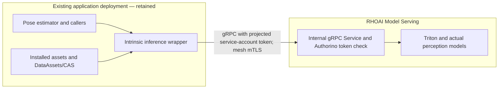

# RHOAI inference migration
> [!NOTE]
> This project was developed with assistance from AI tools.

## Goal and current status

Keep Intrinsic Core, OMTS, simulation, skills, and pose-estimation orchestration
in the cluster. Move the inference resource to RHOAI-managed KServe resources
and preserve the application's Intrinsic inference resource contract.
RHOAI still runs serving pods; ownership by `InferenceService`/`ServingRuntime`
and verified application requests distinguish this from the native StatefulSet.

**Current phase: the dashboard-managed deployment is KServe Ready; internal
gRPC calls from the existing wrapper pod now pass RHOAI authorization and a
synthetic RF-DETR inference.** The wrapper's source adapter is implemented and
unit-tested, but has not been rolled out; the running demo still uses its
existing endpoint. The project is
confirmed visible in the RHOAI dashboard with the
`opendatahub.io/dashboard=true` marker, and the requester has Admin access.
The user confirmed a Triton runtime is available. The dashboard deployment
uses the dedicated
`triton-model-repository-candidate` PVC through
`pvc://triton-model-repository-candidate/snapshot`; KServe mounted it read-only
at `/mnt/models`. RF-DETR and FoundationPose are Ready, live metadata matches
the pinned tensor contracts, and synthetic-input inference passed over gRPC.
Logs confirm CUDA providers and the FoundationPose native CUDA rasterizer on
NVIDIA A10G. The FoundationPose request used a tiny synthetic OBJ, not a demo
fixture. The user created one dashboard-managed deployment. KServe reports it
Ready; Model access created a Route and
`security.opendatahub.io/enable-auth=true` is set. Triton logs show both models
loaded and READY. The OAuth proxy sidecar is present.

The initial external Route failure was traced to mesh ingress policy: predictor
pods need `maistra.io/expose-route=true` for ingress-router traffic. The
installed KServe schema supports setting this label in the InferenceService
predictor template; applying it there allowed a strict-TLS, bearer-token
synthetic RF-DETR REST inference to return HTTP 200. A rollout initially hit an
RWO PVC multi-attach conflict, resolved by setting the owning InferenceService
deployment strategy to `Recreate`; the replacement pod is Ready and the PVC is
intact. gRPC remains unproven: earlier TLS probes negotiated no ALPN protocol,
and the mesh label finding does not explain or resolve that separate transport
failure. Do not connect the application wrapper yet. See the
[handoff](HANDOFF.md) for remaining gates.

The active dashboard deployment uses a REST-configured runtime and requests an
NVIDIA GPU; its current predictor is scheduled on an A10G. The REST deployment
remains the known-good service. For a parallel gRPC test, a separate 2Gi RWO
claim was created and verified as an identical copy of the model repository.
Use `pvc://triton-model-repository-grpc-candidate/snapshot` as the model URI for
that deployment. Keep the original REST PVC and service intact until gRPC is
proven.

The external Route's gRPC ALPN failure remains historical and is not used by
the in-cluster application. The wrapper reaches Triton's h2c port through a
namespace-local ClusterIP Service. RHOAI's mesh policy sends predictor calls
to Authorino; a namespace-scoped AuthConfig now validates projected Kubernetes
service-account tokens and checks `get` access to the named InferenceService.
From the existing wrapper pod, ServerReady, ModelReady, ModelMetadata, and a
synthetic RF-DETR ModelInfer all passed. The token was short-lived and never
printed. See the [handoff](HANDOFF.md) for exact evidence and rollout gates.

E0 remains incomplete. The native wrapper's configured socket discrepancy,
actual artifact identity against pinned bundles, intended wrapper-to-service
identity/auth path, remote load/unload behavior, and demo integration still
need evidence. The
[pinned contract and model inventory](CONTRACT.md) records the FoundationPose
Python/CUDA package and both caller tensor contracts. The [adversarial
review](REVIEW.md) records corrected assumptions, prior-failure evidence,
source anchors, and the required experiment matrix.

The [archived hybrid experiment](../../approaches/tried-not-feasible-aws-vm-with-rhoai/README.md)
provides the serving-runtime and token-authenticated Route workflow to carry
forward. Its cross-environment VM connectivity result is historical. The
former actual-model candidate was created through CLI KServe resources and
used an internal gRPC Service; it did not prove the required RHOAI dashboard
deployment or Model access Route. The prior hybrid Route and certificate
failures are historical. Strict TLS and valid-token RF-DETR REST inference
through the RHOAI-managed Route now pass; missing/invalid-token rejection and
gRPC remain explicit gates. See the
[failure and prior-evidence review](REVIEW.md).

## Target architecture: migrate Triton only



The migration boundary is Triton. Keep the existing inference wrapper, pose
estimator, simulation, and demo deployment in place. First verify the project
in the RHOAI dashboard, configure/select the Triton ServingRuntime through the
RHOAI runtime workflow, and create a model deployment from the dedicated PVC.
Enable Model access and Require token authentication so RHOAI manages the
Route. Verify the Route before changing the existing wrapper. Do not move the
wrapper into the RHOAI serving pod.

The retained wrapper's endpoint adapter now selects the internal gRPC Service,
adds a projected and rotating service-account bearer token to Triton RPCs, and
disables shared memory. Its existing asset synchronization remains in place;
remote repository load/unload calls are skipped because RHOAI owns the models
loaded from the PVC. This must still be validated against the demo's model
catalog and lifecycle before rollout. Keep the current application resource
identity and all other demo components unchanged.

The RHOAI synthetic service has direct gRPC server readiness, model readiness,
metadata, and inference evidence. The native controller and pods remain
unchanged. Native socket resolution, artifact identity, repository delivery,
remote model lifecycle, and actual GPU inference remain open. The candidate's
single serving pod is the Triton model-serving pod; the loaded CIFAR-10 model
runs inside it.

## Source facts and required changes

The application pins Intrinsic Core/OMTS release `20260922.0`. Source references
below describe that release, not an assumed live image version.

| Verified source fact | Consequence for migration |
| --- | --- |
| [Entry point](https://github.com/intrinsic-ai/intrinsic-core/blob/20260922.0/intrinsic_inference/assets/inference_service/inference_service_main.py) uses `unix:///dev/shm/triton.sock:0`, `use_shm=True`, and `/models` | The wrapper must use network gRPC and disable shared-memory exchange when calling RHOAI Triton. An endpoint setting alone is insufficient unless the client honors it and changes transport mode. |
| [Servicer](https://github.com/intrinsic-ai/intrinsic-core/blob/20260922.0/intrinsic_inference/assets/inference_service/inference_service.py) exposes Triton `GRPCInferenceService` and Intrinsic ServiceState | Preserve inference, metadata, readiness, error/status, and lifecycle semantics expected by existing callers. A direct Service alias is not yet proven equivalent. |
| [Runner](https://github.com/intrinsic-ai/intrinsic-core/blob/20260922.0/intrinsic_inference/core/inference_runner.py) forwards `ModelInfer` directly when shared memory is disabled, but also starts model reconciliation | The existing wrapper can be adapted to use remote gRPC, but its current model reconciliation still targets Triton. Define supported remote repository lifecycle and bounded RPC/cancellation behavior before switching it. |
| [Controller](https://github.com/intrinsic-ai/intrinsic-core/blob/20260922.0/intrinsic_inference/core/model_controller_triton.py) writes `config.pbtxt` locally and sends `RepositoryModelLoad`/`RepositoryModelUnload` | The wrapper adapter now suppresses remote repository administration; RHOAI owns the loaded models. Confirm its asset catalog remains consistent with the RHOAI repository and the demo's model lifecycle. |
| [Manifest](https://github.com/intrinsic-ai/intrinsic-core/blob/20260922.0/intrinsic_inference/assets/inference_service/inference_service.manifest.textproto) puts wrapper and GPU Triton together with shared ephemeral model and memory volumes | Keep the application deployment in place while relocating only the Triton server. Replace the shared ephemeral model path with a proven RHOAI repository-delivery design; shared-memory exchange is disabled across the network. |
| [Pose configuration](../deployment/intrinsic-omts/configs/common/pose_estimator_config.textproto) references RF-DETR and FoundationPose assets | Inventory the actual model names, versions, tensors, backends, dependencies, preprocessing/postprocessing, and batch behavior. The synthetic CIFAR-10 result cannot establish compatibility. |
| [Actual pose caller](https://github.com/intrinsic-ai/intrinsic-core/blob/20260922.0/intrinsic_perception/intrinsic/perception/service/ioc_pose_estimator/service/ioc_pose_estimator_service.py) calls the existing wrapper over gRPC with static dependency metadata | Keep that caller and wrapper-facing resource path unchanged. Establish the new internal wrapper-to-RHOAI-Triton transport/auth path separately; do not expose Triton directly to the pose caller. |
| [Native adapter](../deployment/chartassignment-controller/controller/openshift.go) patches the wrapper CAS address and injects ingress settings | Preserve the effective startup behavior, not just image references. A KServe pod does not automatically receive ChartAssignment-specific patches. |

## Sequential implementation tasks

Each phase must meet its acceptance gate before progressing to changes that
depend on it. Record only sanitized outcomes here; keep addresses, identities,
payloads, device identifiers, and raw inventories outside tracked files.

| Phase | Deliverable | Acceptance gate | Rollback / failure response |
| --- | --- | --- | --- |
| **0. Establish the RHOAI project and runtime path** | Project visible in RHOAI; Triton runtime available; existing PVC accepted as model source | Confirmed: project visible, Triton runtime selectable, and PVC mounted successfully by the deleted CLI candidate. | Keep the native application deployment and dedicated model PVC intact. |
| **1. Create the RHOAI model deployment** | Dashboard-managed REST deployment using the PVC-backed Triton repository | REST deployment is KServe Ready. Strict-TLS bearer-token REST inference for synthetic RF-DETR returned HTTP 200. External missing/invalid-token rejection and Route gRPC remain unproven. | Keep the REST deployment and original PVC intact; do not hand-create or patch the Route. |
| **2. Prove required models through the managed Route** | Authenticated RHOAI Route serving RF-DETR and FoundationPose | Both models load and become READY. RF-DETR synthetic inference passed through REST; FoundationPose Route inference, model identity against pinned bundles, request/response metadata, and update/rollback ownership remain open. | Keep the REST deployment and original PVC intact; use the copied PVC for a parallel gRPC candidate. |
| **3. Connect the existing wrapper** | Narrow wrapper Triton-client endpoint/transport and credential change | Implemented and unit-tested: internal gRPC Service, projected token, no shared memory, and no remote load/unload. In-cluster ServerReady/ModelReady/Metadata/ModelInfer pass. Still validate the unchanged demo, failure/deadline behavior, model catalog lifecycle, and rollback before rollout. | Revert endpoint/configuration through its owner; verify it calls native Triton again. Leave every other demo component unchanged. |
| **4. Validate unchanged demo and rollback** | Existing demo path calling RHOAI Triton, with native rollback ready | Run the existing demo flow without modifying pose-estimator, simulation, or other services. Correlate requests with RHOAI Triton, verify expected outputs/errors and measured latency, then exercise Triton outage and native reversion. | Restore the native Triton endpoint and confirm the existing demo works. |
| **5. Handover** | Reviewed operations and capacity record | Confirm artifact update/rollback, endpoint identity rotation, health/readiness ownership, GPU use, and removal of the old Triton sidecar only after acceptance. | Keep the native Triton configuration recoverable until ownership is accepted. |

The implementation boundary remains the Triton server plus the minimum wrapper
client/configuration change needed to reach it. The demo's other services and
behavior are held fixed. If the current wrapper's dynamic model administration
cannot be preserved against RHOAI Triton, document the smallest lifecycle
adapter or shared-repository mechanism that preserves the demo's model behavior
before implementation; do not hide that change behind an endpoint-only setting.

## Decisions to resolve in phase 0

- **Runtime and mode:** use the installed RHOAI Triton runtime/template and
  version-matched documentation. The wrapper remains in the existing app pod.
- **Namespace:** use the existing application project. Its dashboard label and
  requester Admin access are present, and the display name includes the actual
  namespace. User/UI confirmation that it appears is still required. Preserve
  existing bindings and PVCs. Never put application models in platform
  namespaces.
- **Model ownership:** RHOAI owns Triton server deployment and health; explicitly
  define whether models come from an approved immutable repository or a shared
  repository with controlled load/unload. Preserve the model versions that the
  current wrapper exposes to the demo.
- **Identity and network:** configure Model access and token authentication in
  the RHOAI model deployment workflow. Verify the generated Route, TLS, and
  token behavior on this cluster. Prove the wrapper's supported route protocol,
  credential delivery, and rotation. Do not expose model repository
  administration. Enumerate separate inference and ServiceState access rather
  than assuming one proxy route covers both.
- **Placement and capacity:** do not assume unused allocatable GPU slots are
  free physical GPUs. Preserve the running baseline; confirm scheduling, memory,
  quota, and concurrent capacity before creating a GPU candidate. If parallel
  validation cannot fit, prepare a reversible serialized validation schedule
  using the recorded native baseline; do not silently overcommit or evict it.

Do not change the demo's other services or call the migration complete until the
RHOAI Triton path and native rollback are proven.

## Run the read-only platform preflight

Use a current local login and explicit settings. Copy `.env.sample` to this
directory's ignored `.env`, replace its placeholders, then export it:

```sh
set -a
source openshift/rhoai/.env
set +a
python3 openshift/rhoai/preflight.py
```

The command reads cluster objects and `oc auth can-i` results only. It does not
read Secrets, print addresses/identities/raw CLI errors, create resources, or
change kubeconfig. Missing discovery permission is reported as incomplete
evidence rather than absence of the platform. It returns nonzero for blockers.
Exit zero means only that the bounded discovery checks completed. Its report
keeps `phase_0_complete` and `candidate_deployment_ready` false until the actual
models and integration gates pass. A Managed setting/dashboard marker is not
serving readiness. The JSON report is a local diagnostic; do not commit a live
report.

## Inspect the RHOAI model deployment

With the namespace selected in `RHOAI_SERVING_NAMESPACE`, inspect the RHOAI
resources and their generated workload:

```sh
oc get inferenceservice,servingruntime -n "$RHOAI_SERVING_NAMESPACE"
oc get pods,services,routes -n "$RHOAI_SERVING_NAMESPACE"
oc get pvc triton-model-repository-candidate -n "$RHOAI_SERVING_NAMESPACE"
oc get pvc triton-model-repository-grpc-candidate -n "$RHOAI_SERVING_NAMESPACE"
```

For the current parallel protocol test, keep the REST InferenceService and
create a gRPC candidate using the copied PVC. The current REST predictor
requests a GPU and selects A10G nodes; verify the new candidate's GPU request
and placement after rollout. The eventual application target remains one
selected RHOAI-managed token-authenticated model endpoint.

## Internal wrapper-to-Triton access

The existing wrapper uses the internal gRPC Service on Triton's h2c port. Apply
the namespace-scoped Service, RoleBinding, and Authorino AuthConfig manifest
with the selected RHOAI namespace and InferenceService name:

```sh
RHOAI_NAMESPACE="$RHOAI_SERVING_NAMESPACE" \
RHOAI_INFERENCESERVICE_NAME="<grpc-inferenceservice-name>" \
  envsubst < openshift/rhoai/manifests/triton-grpc-internal-service.yaml \
  | oc apply -f -
```

The wrapper's existing service account receives only `get` access to that
InferenceService. Its gRPC client uses a projected short-lived token with the
Kubernetes API audience; Authorino validates the token and checks the same RBAC
permission. Do not use the external Route for this in-cluster request.

## Definition of complete

Existing application calls use an Intrinsic-compatible resource backed by an
RHOAI-managed serving endpoint. The actual perception models execute in its
serving pods on the approved GPU with verified outputs and measured latency. Artifact ownership,
authentication, mesh/network rules, reconciliation, restart behavior, and native
rollback have been demonstrated. A Ready pod or a synthetic smoke alone does
not meet this definition.
